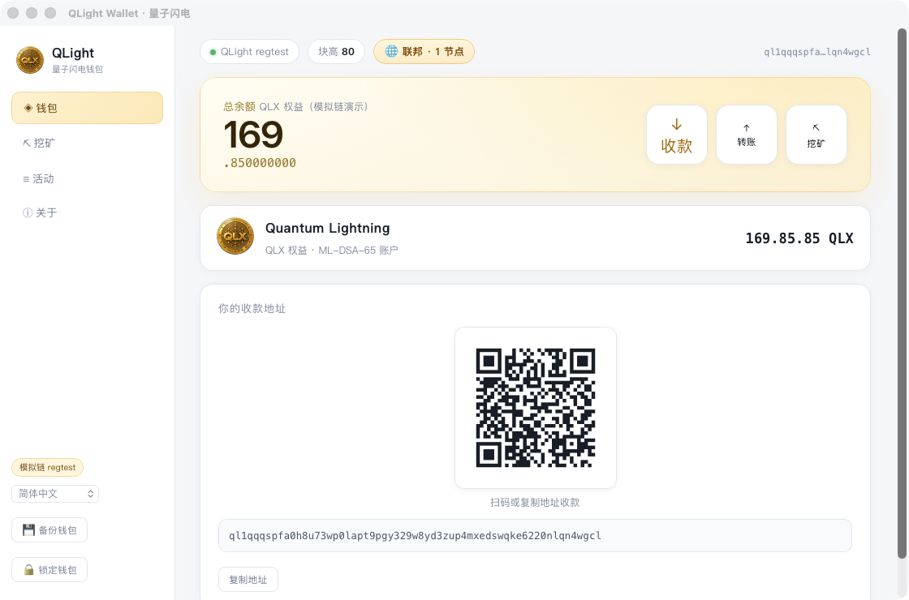
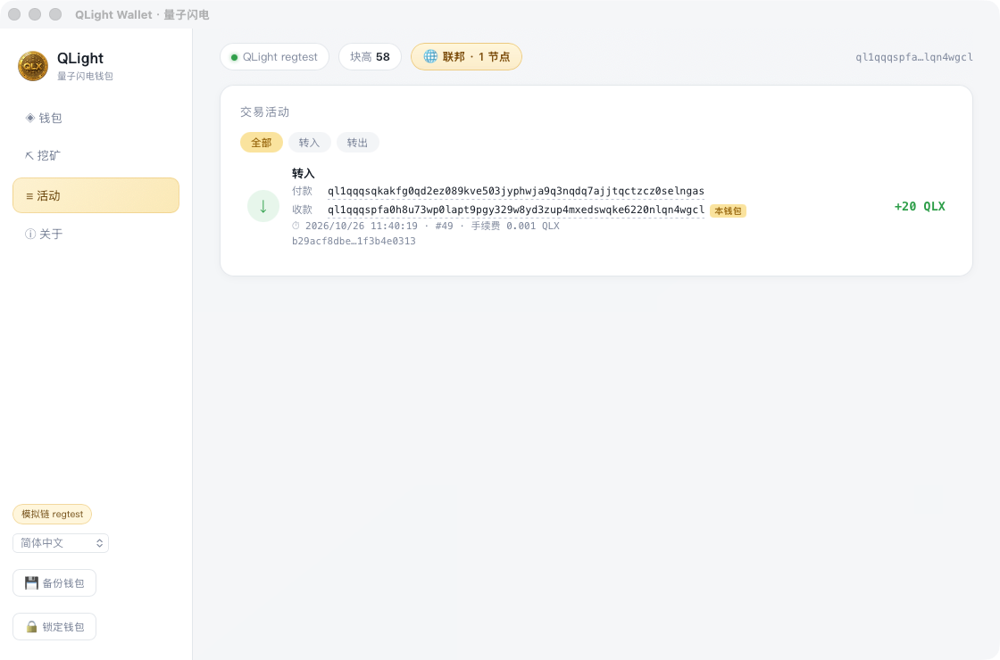
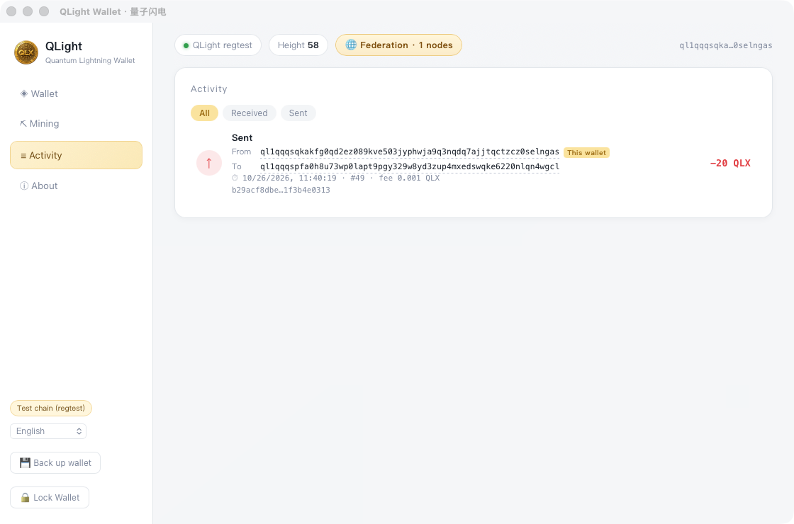

# QLight Wallet · 抗量子桌面钱包

<p align="center">
  
</p>

<h3 align="center">🛡 下一代抗量子桌面钱包 · 联邦网络 · 公平启动</h3>

<p align="center">
  <a href="https://github.com/yuanhong792/qlight-wallet/releases/latest/download/QLight-Wallet.dmg"></a>
  <a href="https://github.com/yuanhong792/qlight-wallet/releases/latest/download/QLight-Wallet-Windows.zip"></a>
  <a href="https://yuanhong792.github.io/qlight-wallet/"></a>
  
  
</p>

---

> **⚠️ 诚实声明（必读）**：QLX 是**演示与教学用途的「凭证/权益」记账单位，不是投资品**，不承诺任何价值，不构成任何证券或虚拟货币发行。当前版本为**双机演示 / 小圈内测阶段**，共识规则为演示级，不具备对抗恶意节点的拜占庭容错。在您所在司法辖区使用前，请自行确认合规性。

## 📸 界面一览

| 主界面（余额 / 收款码 / 联邦状态） | 活动明细（收款方视角 · 双方地址直显） |
|:---:|:---:|
|  |  |

**同一笔转账，在付款方钱包里的样子**（英文界面 · From/To 完整地址 + "This wallet" 标注）：

<p align="center"></p>

## ✨ 特性

- **🛡 抗量子签名** — 全部交易使用 **ML-DSA-65**（NIST **FIPS 204**，Dilithium 家族）。今天截获的交易数据，未来量子计算机也无法伪造。
- **🌐 联邦网络** — libp2p + mDNS + gossipsub。同一局域网的钱包**自动发现彼此**，无需服务器、无需公网 IP，账本全网一致；快照压缩同步 + 分叉即时裁决。世界也一样对齐：每 9 秒公告整本实体账本的**集合指纹**，掉线期间漏掉的方块会被发现并主动补回（补回来的记录仍逐条验签验链）。
- **🌱 公平启动** — QLX 全部通过**挖矿产出**：无预挖、无 ICO、无投资人份额。总量封顶 **2.1 亿**，每 31.5M 块减半，约 60 年排完。
- **📜 创世宣言上链** — 借鉴比特币创世块：宣言原文经 SHAKE-256 嵌入创世哈希，**改一个字全网即可识破**，链的价值观从第 0 块被锚死。
- **💱 2 秒结算** — 出块周期 2 秒，手续费固定 0.001 QLX；「确认中」状态一目了然，入块即到账。
- **🔐 本地加密存储** — 密钥库 **AES-GCM + Argon2** 加密落盘；账本与块文件**全路径原子写 + fsync**，启动时哈希链校验，崩溃自愈。
- **🔍 活动明细** — 每笔转账：付款方 / 收款方**完整地址**、精确时间、块高、哈希、真实手续费**全部直显**；8 种语言界面。
- **💾 备份恢复** — 一键导出 / 导入 `.dat` 备份（密码不变）。

## 🚀 快速开始（两台电脑联邦转账）

1. **安装**：从 [Releases](https://github.com/yuanhong792/qlight-wallet/releases/latest) 下载并安装（macOS 拖入应用程序；Windows 解压双击 exe，exe 与两个 DLL 同目录）。
2. **组网**：两台设备连同一 Wi-Fi，各自打开钱包，左上角出现「🌐 联邦 · 2 节点」即成功（同一台电脑开两个实例也可以，第二个实例自动落到 `node-1` 数据目录）。
3. **转账**：收款方「收款」页复制 `ql1` 地址 → 付款方「转账」页粘贴、输入金额 → 签发。
4. **到账**：约 2 秒入块，双方「活动」页自动刷新，完整明细直接可见。

## 🏗 技术架构

```
┌─────────────────────────────────────────────┐
│  QLight Wallet (Tauri 2 + Rust)             │
│                                             │
│  UI (8 语言)  ←→  Tauri Commands            │
│                     │                       │
│      ┌──────────────┼──────────────┐        │
│      ▼              ▼              ▼        │
│  SimChain        ML-DSA-65      libp2p      │
│  · 2s 出块       (FIPS 204)     · mDNS      │
│  · 门票选举      AES-GCM        · gossipsub │
│  · 封顶排放      + Argon2       · 快照同步  │
│  · 哈希链校验    密钥库         · 分叉裁决  │
└─────────────────────────────────────────────┘
```

- **桌面**：Tauri 2（Rust 后端 + WebView 前端，无打包链，UI 嵌入二进制）
- **密码学**：`ml-dsa`（FIPS 204）· SHAKE-256 · AES-GCM + Argon2id · bech32 地址（`ql1…`，32 字节 commitment）
- **链**：SimChain 演示链（创世宣言锚定 → 门票选举出块 → 奖励减半 → 2.1 亿硬顶；blocks.jsonl 逐块审计，启动重放校验）
- **网络**：B 档联邦（libp2p mDNS 发现 + gossipsub 广播 + 共享引导注册表；gzip 压缩快照追账；票/块双探测分叉裁决）

## 🌍 世界是算出来的（确定性世界）

本项目对"元宇宙"的立场是一句**可证伪**的话：`world = render(种子, 规则, 历史)`，
而它与区块链的状态转移 `state(n+1) = f(state(n), tx(n))` 是同一个数学对象——**链就是世界的存档，币就是世界本身**。

这句话已经被实验证明了一次：`tools/world/` 下有 Python 与 JS 两份**运行时完全不同**的参考实现，`docs/world.js` 是官网用的第三份，钱包里跑的是第四份——四者从同一份链历史渲染出**逐位一致**的像素。

```bash
python3 tools/world/world.py                        # 默认：只用创世哈希作种子
python3 tools/world/test_rules_v2.py                # 断言下面这张表（改渲染器不改版本号会被当场拦下）
node tools/world/world.js --blocks <你的>/blocks.jsonl   # 用你自己的链历史
node tools/world/test_first_person.js               # 零依赖：DOM/WebGL 桩跑通"低头连点原地起柱→踩上去→拆掉自己那块"
python3 tools/world/test_ore_v1.py                  # 矿脉规则 QL-ORE-v1：现场生成 ore_golden.json（缺 node 时跳过 JS 侧，需 NODE_BIN=/path/to/node）
cargo test --lib ore::tests::ore_matches_cross_language_golden   # Rust 共识侧拿同一份基准复核
```

| 输入 | 像素指纹（双 FNV-1a，16 hex） |
|---|---|
| 只有创世哈希 | `bb95cc46d3bc8f90` |
| 创世 + 718 个真实块 | `958bd93f93363143` |
| 同一历史，规则常量 `0xd120fe8f` → `+1` | `f4f3ee18cd05b9d2` |
| 创世 + 240 个合成 VRF（四份副本对拍） | `90d19d515c01835f` |
| **只算高度场**：创世 vs 创世 + 240 历史 | `7b2863f076bce5fa` —— 两个输入同一个值 |

最后那一行是**能不能建造**的关键：种子分成两条道——大地（高度场）只由创世哈希决定，永不动；
地表（湿度/生物群系）才混入链历史。因为实体记录的是 `(x, z, layer)` 且 `layer = 高度场 >> 3`，
地面若每出一个块就漂移一次，"我占了这一格这一层"这条被签名的承诺就不再可复算。
**世界必须先是稳定的舞台，才谈得上在上面创造**——历史塑造世界，改的是地表而不是大地。

四份实现在上面这些基准上**全部逐位吻合**。所以：多挖一个块，地表就真的重画一次；改一个规则常量，整片世界面目全非，而所有实现同时跳。

- 想直接看：官网 [「世界是算出来的」](https://yuanhong792.github.io/qlight-wallet/#world) 一节可在浏览器里跑同一个渲染器，并拖入自己的 `blocks.jsonl`（本地解析，不上传）。
- 想直接造：钱包里的 **🌍 世界**页就是编辑器——俯视图点一格，或按「进入世界」以**第一人称**走进去：右键落下方块、左键拆掉自己签的方块、低头对准脚下连点就是一层一层原地起柱，再踩上去。**建造不收费，但要材料**：土/石/矿只能从世界里挖出来（见下一条），放置按材料扣账。每一次编辑都是一条 ML-DSA-65 记录，永久进账本。**链只保存坐标与归属，像素全部在每台本机各自算出来。**
- **地形可以挖，而且挖多少层是共识规则**：对准露在最上面的那一层按左键，就剥掉一层、材料当场进账——一条 `op=dig` 记录，不是本地删像素。只能挖**露出来的顶面**（跳过一个块去挖底下那层会被拒），水面挖不动，一层一层往下直到岩床（第 1 层）。深度按带分材料：地表 1–3 层出泥土、4–9 层出石头、10 层往下出矿。服务器自己用「地表层 − 已挖层数」算出该挖哪层，前端报的层号不算数——"我挖到了什么"由大地高度场说了算（DESIGN §9.20）。
- **挖矿才发币**：点「⛏ 挖本回合矿脉」，程序在本回合矿脉里挑一格、落一个签名方块并提交发行凭据；下一个块收下凭据，才发行新币。发行按**节奏档**结算：每笔最多结清一个当前档位的块数（新钥匙 50 块，随这把钥匙落下的矿格数逐档降到 10 块），**空块不补发**——等得再久也不会把中间空档一次性印出来。没有矿签的块零发行——币是挖出来的，不是计时器印的。每块平均发行量不超过 `reward_at(h)`，2.1 亿硬顶与减半不变（DESIGN §9.13）。
- **世界里的东西现在是账，不是贴图**（0.4.0）：地里长资源（`QL-RES-v1`：600 块一轮、第 400 块起入夜产出减半、每地址每轮 60 格配额，树 60 / 石 15 / 花 5，种子只由创世哈希 + VRF 序列推出，与地形同一口径）；采到的**光尘**走逐归属者签名账本（`QL-DUST-v1`，余额按 `(height, record_hash)` 全局排序折入，出块人排不动结果）；光尘↔QLX 有恒定乘积**兑换池**（`QL-POOL-v1`，0.3% 归 LP，u128 整数曲线**在共识里**，f64 价格只供显示）；世界里的**旅人摊位**卖的是工夫（最优路线 / 冷清之地 / 这一轮谁在采），付款是一条普通 `send` 到烧毁地址——光尘真被烧掉，这是软币的回流阀。
- **不可作假这件事写死在共识里**：采集的轮次、每轮配额与"同一格本轮只能采一次"的判据**只认真正收下这条记录的那个块高**，记录自报的块高一律不作数（0.4.1 收紧）。在此之前，脚本可以一次签出一批指向历史轮次的采集记录，把 60 格/轮的配额刷 N 遍，还能挑一个"白天"的块高躲掉夜间减半——发行量、稀缺性和池子里的价格都能被一台机器凭空放大。现在这条路封死，代价也明说：恰好压在轮次／昼夜边界上、晚一个块才被收下的记录会当场被拒，重签一次即可（DESIGN §9.17）。同轮补上产出侧的统一前置：**世界整本重放不过，就不许采**——采集与挖矿、放置、挪动、拆除走同一道 `live_world()`，一台实体账本悄悄少了几行的机器不能一边用另一本世界一边产光尘（光尘能经兑换池换回 QLX）。说清还没做到的：地表坐标全网可算，这道前置挡的是**账本分歧**，不是**脚本算坐标**——在场广播（`QL-POS-V1`）已经能看见"谁此刻在哪"，但它只是画面数据、不进账本也不进任何判据，把它变成共识判据才算封死（DESIGN §9.19）。
- **像游戏一样启动**：欢迎页先给方向（进入世界 / 如何游玩 / 创建或恢复钱包），技术参数收进「高级」折叠区；第一次进世界有 4 步引导清单——第 2、3 步（挖掉一层、放下第一个方块）以**账本重放**为准，第 1、4 步（进过世界、看过活动）只是导航状态，不伪装成链上事实。「关于」页有本地反馈导出（`QL-FEEDBACK-v1`：默认不带私钥、不带地址、不带截图，勾选才带）与联机三态说明（本地 / 局域网可用，公网**未实现**）；第一人称里「📷 截图」把画面 PNG 与坐标文案一起导出，复制那行坐标就能直接发出去。世界 HUD 另有一行**在场**：同一张联邦网里的邻居此刻在哪（§9.19，只展示，不进账本、不换收益）。
- **可玩性**：16 种一眼认得出的像素物件（石头/橡树/花丛/木屋/木桥/灯塔/篝火/篱笆/鹿/鸟/鱼/蝴蝶/兔/绵羊/旅人/狼），同一套贴图贯穿俯视图、物品栏、手持与 3D；600 块一昼夜（日月星、雾、色调）；放置/拆除粒子、脚步与放置/拆除/领取音效、走路头部起伏。活物是被签名的实体，不是本地动画（DESIGN §9.15）。
- **画面层（0.4.2）**：第一人称世界之上叠了一层 Three.js（WebGL）——摆在同一份高度场与实体表上，只做美术：色调映射、环境光、阴影、实例化树林与草石、昼夜天空着色器、雾、远山与城堡地标。它**不产出一条账本记录**，WebGL 不可用时整层隐藏、回到 Canvas2D，玩法与收益一分不变（DESIGN §9.22）。进世界先铺欢迎页那张黄昏封面，第一帧渲染好再淡出 1.1 秒——封面不是诱饵，是"淡入后落在同一个地方"的同一片世界；出生点按"近处有落差、远处有景、看得到水面、不站树里不贴墙"打分挑选，第一眼不是一根树干。**换引擎不是解**：Three.js 已经是 WebGL 引擎，缺的是画法不是引擎，换 Godot/Unity 只会把"单包 + 离线 + 像素本机算"这三条丢掉。
- **自己看画面**：`desktop-wallet/ui/scene-preview.html` 是纯前端预览页，`?t=day|dusk|night`、`?px=&pz=&yaw=&pitch=`、`?shadow=0`，与钱包内用的是同一个 `ThreeWorld`、同一套出生点评分——不用装应用也能对拍构图。
- 与 Minecraft 刻意不同的一条：**地形能挖，但挖是记账不是删像素**。被签名进账本的是"这一层被谁剥掉了"（`op=dig`），不是本地画面上的一个洞；同一份 `entities.jsonl` 在任何机器上重放，坑都一样深。"拆"自己造的方块 = 释放那条记录的归属（断租不删除，记录永久可查，体素重新可造）。
- 只有**头**所在的那一格算被身体占用，脚下那格允许落块：块一落地人就被抬上去，于是"低头、连点"就是原地起柱，一次点击一块。准星够不到东西时一定有提示——这个编辑器不许无声失败。
- 完整规格：[DESIGN.md §9 元宇宙运行时](DESIGN.md#9-元宇宙运行时l2)（确定性算术规范、规则版本化、VRF 随机源、可验证边界、世界经济学、彼此指认的存在证明）。
- **诚实边界**：状态可验，像素不可验——渲染器不是共识的一部分；实体账本与 `chunk_root` 已落地（`src/world.rs`，`QL-ENTREC-v5` 逐条验签 + 哈希链 + 窗口配额），**整本世界承诺也已进块**（v2 块绑 `entity_root` + `entity_count`，v5 起再加 `dust_root` + `dust_count`，见 §9.12 / §9.17），所以离线替换整本账本会在块上留痕；仍未做到的是逐 `chunk_root` 的分块承诺与"一格两主"的最终裁决，租约与 `StreamGrant` 仍是**只有规格，0 行代码**。块版本 v1 起发行规则改变、v2 起世界承诺进块、v3 起节奏阶梯、v4 起块哈希绑 `miner`/`ts_unix`、v5 起光尘进块且块高 200 之后只认 v5：新旧客户端会在首个对应版本的块之后**静默分叉**——0.4.1 起网络条把这种分歧直接报出来（规则指纹不同 = 红；指纹相同但发行包不同 = 金虚线，因为家族内改判据一样会分叉，见 §9.18）。版本普查比对的是邻居**声明**的指纹，不是证明；真正的规则一致要靠门票 VRF 证明 + 罚没（M2.2）。

## 📚 文档

| 文档 | 内容 |
|---|---|
| [whitepaper.md](whitepaper.md) | 白皮书（架构 / 共识 / 经济模型 / 合规红线） |
| [DESIGN.md](DESIGN.md) | 技术设计底稿（§14 协议规格） |
| [TOKEN.md](TOKEN.md) | QLX 凭证经济 |
| [benchmark.md](benchmark.md) | 性能基准（实测） |

## 🗺 路线图

| 阶段 | 内容 | 状态 |
|---|---|---|
| M1 | 双机演示 / 自用（联邦转账闭环 + 崩溃安全存储 + 创世锚定） | ✅ **当前** |
| M1.5 | 小圈内测（启动交叉校验完善 + 基本防恶意） | 🚧 |
| M2.2 | 门票 VRF 证明闭环 + 作恶罚没 + 拜占庭容错 | 规划 |
| 公开上线 | 签名分发 + 自动更新 + **合规评估（硬前置）** | 规划 |

## 🪟 / 🍎 平台备注

- **Windows**：运行只需三件（exe + WebView2Loader.dll + libunwind.dll）同目录，zip 里另附 `README.txt` 讲清建造与挖矿；SmartScreen「更多信息 → 仍要运行」；防火墙选「允许」。
- **macOS**：首次打开「无法验证开发者」→ 右键 → 打开（未公证提示，仅一次）。
- **数据位置**：macOS `~/Library/Application Support/net.qlight.wallet/`；Windows `%APPDATA%\net.qlight.wallet\`。
- **块格式 v1 → v5**：新块 `version = 5`，块哈希域为 `QL-BLOCK-V6`（v1=`QL-BLOCK-V2`、v2=`QL-BLOCK-V3`、v3=`QL-BLOCK-V4`、v4=`QL-BLOCK-V5`，同一组字段换个版本就是另一条链；v0 旧块仍按 `QL-BLOCK-V1` 重放，不重写任何历史）。v1 起发行必须有矿签，v2 把**世界承诺**绑进块哈希——`entity_root`（出块人此刻整本实体账本的集合指纹 `QL-ENTSET-V1`）+ `entity_count`，离线替换 `entities.jsonl` 会在块上留痕、条数倒退当场拒收；v3 起发行改按节奏档结算且**空块不补发**；v4 再把 `miner` 与 `ts_unix` 绑进块哈希，杜绝无矿签块改 `miner` 偷手续费/奖励；v5 把**光尘**锚进块（`dust_root` + `dust_count`，块行带原件），采集配额与兑换池价格从此是全网一致的状态。旧版本块只允许在激活高度之前出现（v5 为 `≤ 200`），之后只认 v5——**这是硬分叉**。
- **联邦版本告警**（0.4.1）：链公告 `Announce` 带上 `app_version` 与规则指纹 `rules`（出块域 ‖ 实体记录语义 ‖ 光尘语义）。指纹不同 = 一定互相验不过对方的块，网络条报红「规则分歧」；指纹相同但发行包不同报金虚线「版本不齐」——同一规则家族里改过判据（0.4.1 把光尘轮次改成只认真正进块的块高）两端同样会分叉。**分叉是静默的**：连接层、日志、UI 此前都没有任何信号，这条 chip 是唯一能看见它的地方，所以组网演示请两端跑同一个发行包。
- **账本健康**（0.4.1）：实体／光尘两本账整本逐行读，解析不了的行**只跳过它自己那一行**并计数（旧口径遇到坏行就停止读，多方交错的一行坏会把后面所有人的全部历史静默丢掉）。坏行数非零时世界面板显式写「账本坏行：实体 X 行 / 光尘 Y 行」——少读几行等于本机拿另一本账去参与共识，而条数与指纹都会进块承诺。
- **链重置不再把世界账本落下**（0.4.2）：`blocks.jsonl` 自检不过时链会归档重置，但世界账本是它的派生物——旧账留在原地时，新链的链尖永远追不上旧记录的块高，重放第一条就失败，世界从此写不进去。现在重置**同一代**就把 `entities.jsonl` / `dust.jsonl` 一起改名归档（`*.bak-world-<tag>`，只改名不删除）；已经留下孤儿账的机器，世界页会出现「归档旧世界账本（保留备份）并继续」，确认后只归档验不过的那本。为什么不自动：整本账落在链尖之上也可能只是本机 `blocks.jsonl` 被换成了更早的备份，自动归档等于替人丢掉一段能长回来的历史（DESIGN §9.21）。判据不只看块高：链会一直长，v3 记录再对「买单交易在不在链上」，所以这个出口不会因为链追上旧高度而消失。

## 🔨 从源码构建

版本号只有一个来源：`desktop-wallet/Cargo.toml`。`tauri.conf.json` 与之同步，打包脚本从这里读，前端「关于」页的 `版本 {v}` 由 Rust 命令 `app_version` 运行时注入——写死在任何一处都必然过期。

```bash
cd desktop-wallet
zsh scripts/build-macos.sh      # → build/QLight-Wallet.dmg（cargo + codesign + hdiutil，无需 npm/tauri-cli）
zsh scripts/build-windows.sh    # → build/QLight-Wallet-Windows.zip（macOS 上用 llvm-mingw 交叉编译，无需 Windows 机器）
```

- Windows 目标必须是 `x86_64-pc-windows-gnullvm`：普通 `*-gnu` 的预编译 std 要链 `-lgcc/-lgcc_eh`，而 llvm-mingw 是 LLVM 实现、不提供 libgcc（见 `desktop-wallet/.cargo/config.toml`）。
- 打包脚本会**自己校验导入表**：除系统 DLL 外若冒出第三个非系统依赖就直接失败退出——"三文件同目录"是可验断言，不是文档传说。
- 交叉编译需要 llvm-mingw（脚本自动找 `~/qlx-tools/llvm-mingw-*`，或显式 `MINGW_HOME=/path`）。
- **编译输出必须放内置盘**（脚本已固定）：外置 exFAT 卷会生成 `._*` 资源叉，既破坏构建也会污染发布用的 zip。

## 📄 许可与免责

本项目用于研究与教学演示。QLX 非投资品，不构成任何发行行为；公开上线前需完成合规评估。使用本项目产生的任何后果由使用者自行承担。
